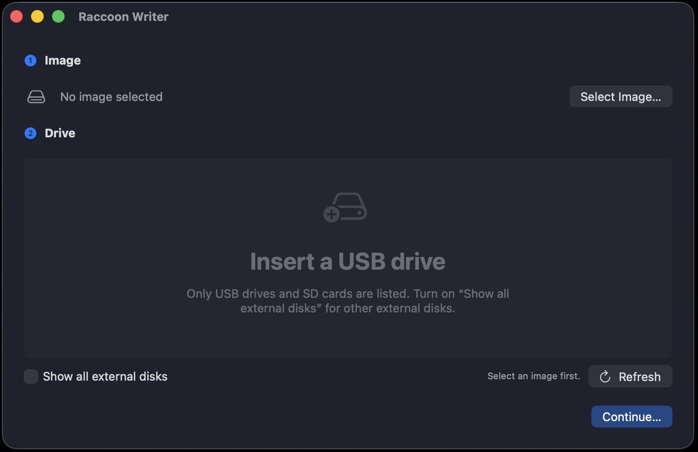
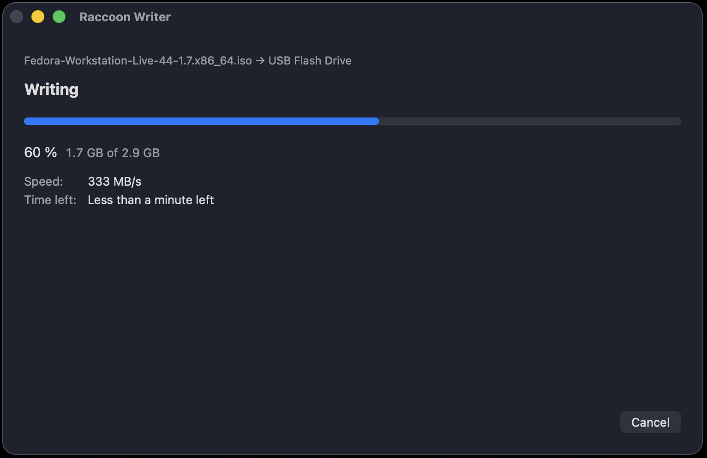

# Raccoon Writer

**Raccoon Writer** is a native macOS app (Swift/SwiftUI) that writes `.iso` and `.img` disk images to USB drives, for example to make a bootable Linux installer. It does the same job as balenaEtcher and Fedora Media Writer: pick an image, pick a drive, confirm, and it writes the image, reads it back to verify it, then ejects the drive.





> **Status:** v1 is feature-complete, covered by unit tests, and has passed the hardware checklist in [`docs/HARDWARE_TESTS.md`](docs/HARDWARE_TESTS.md) on an Apple Silicon Mac, writing to a SanDisk Cruzer Glide USB stick and an SD card in the built-in slot. A Fedora Live ISO and a FreeBSD `.img` were written, verified, and booted on another machine. The one test not run is the Intel Mac run (H13): the only Intel Mac available runs macOS 13, and the app needs macOS 14, so the Intel half of the universal binary is untested. See [`PLAN.md`](PLAN.md) for the full history.

## Download

Download `RaccoonWriter-<version>.dmg` from the [latest release](https://github.com/nthorp/raccoon-writer/releases/latest), open it, and drag Raccoon Writer to Applications. It needs macOS 14 or later, on Apple Silicon or Intel.

The app is signed with a Developer ID (Northwoods Digital LLC) and notarized by Apple, so it opens without Gatekeeper warnings. To check the download, compare `shasum -a 256 RaccoonWriter-<version>.dmg` with the `.sha256` file on the release page.

## Safety: what the app erases

**Writing an image erases the entire target drive**: every partition and every volume on it, not just one volume. The data cannot be recovered.

Several checks keep the wrong disk from being written:

- **The drive list hides disks that are never safe targets.** The boot disk (including its APFS container and the physical disk behind it) and every internal disk never appear, under any setting. The one exception is an SD card in a Mac's built-in SD card slot, which macOS reports as internal. It is listed only when macOS reports all of these: the Secure Digital bus, removable media, a physical device and a whole disk. Every other check still applies to it, so a card macOS started up from stays hidden. By default the list shows external USB drives that macOS reports as removable or ejectable, plus that SD card. That covers USB sticks and card readers, but also most USB hard drives and SSDs, so a backup or Time Machine drive can appear. "Show all external disks" adds other external disks, such as Thunderbolt SSDs. If the app can't work out which disk is the boot disk, the list stays empty.
- **Drives over 500 GB are marked "Large drive"** in the list, and the confirm screen warns that the drive may be a backup or external hard drive. USB sticks are rarely that big. The warning doesn't stop the write.
- **Volume names are shown** on each drive's row in the list (for example "STICK · 16 GB · /dev/disk4 · USB") and on the confirm screen, so two identical sticks can be told apart.
- **A confirm screen** shows the drive's name, size, `/dev/diskN`, volume names and mounted volumes, and requires a click on **Erase and Write**.
- **macOS asks for an administrator password** before every write, in a dialog that names Raccoon Writer. The app hands the resulting authorization to `authopen`, the macOS tool that opens the disk and passes it back. The app itself never runs as root.
- **A safety check right after the password dialog** queries the disk again and stops if it has disappeared, changed (different size, name, block size or bus), or no longer passes the filter. It runs after the dialog, not before, because the dialog can stay open indefinitely: if the drive is unplugged meanwhile, another disk can take over its `/dev/diskN` name.
- **The opened disk is checked too.** Its size and block size must match the disk the safety check just approved, or nothing is written.

After a cancelled or failed write, the drive's contents are undefined. The app says so and tells you what state the drive was left in.

## Requirements

- macOS 14 or later, on Apple Silicon or Intel. The app is a universal binary.
- To build: Xcode 26 or later. The app icon (`App/AppIcon.icon`) is an Icon Composer file, which older Xcode versions can't compile. Command Line Tools alone can run the unit tests but not build the app.
- [XcodeGen](https://github.com/yonaskolb/XcodeGen): `brew install xcodegen`

## Build and run

```sh
scripts/test.sh
scripts/build.sh
scripts/build.sh --release
open build/RaccoonWriter.app
```

- `scripts/test.sh` runs the unit tests for ImageWriterCore (`swift test`).
- `scripts/build.sh` generates `RaccoonWriter.xcodeproj` and builds a universal Debug `build/RaccoonWriter.app`.
- `scripts/build.sh --release` builds Release, then checks that no debug-only test switches are in it.

The Xcode project is generated from `project.yml` and is not checked in. A build from source is ad-hoc signed. Release downloads are made with `scripts/release.sh` (Developer ID signature, notarization, DMG) and `scripts/publish-release.sh`; see [`docs/RELEASING.md`](docs/RELEASING.md).

### Debug-only test modes

These exist only in Debug builds. The Release build check fails if any of them leaks into a Release app.

- `RACCOONWRITER_SIMULATE=1 build/RaccoonWriter.app/Contents/MacOS/RaccoonWriter` runs the whole UI against simulated drives backed by temp files. It never calls `diskutil` or `authopen`. Each simulated drive scripts one outcome (success, drive pulled out, verification mismatch, password prompt cancelled, drive too small, a 1 TB USB hard drive that shows the large-drive warning, an open blocked by the privacy settings, and an SD card in a built-in slot). See T10 in `PLAN.md`.
- `RACCOONWRITER_ALLOW_VIRTUAL_DISKS=1 build/RaccoonWriter.app/Contents/MacOS/RaccoonWriter` also lists **unmounted** disk images, so you can test a real write against a RAM disk (`hdiutil attach -nomount ram://1048576`) without a USB stick. See H2 in `docs/HARDWARE_TESTS.md`.

### Logs

The app logs to the unified log under subsystem `com.raccoonwriter.app`:

```sh
log stream --predicate 'subsystem == "com.raccoonwriter.app"' --info
```

## How it works

```
Select image → Select drive → Confirm
  → password prompt (Security.framework, names Raccoon Writer)
  → safety re-check → diskutil unmountDisk
  → authopen -extauth (no second prompt; opens the disk, returns an open file descriptor)
  → size check of the opened disk
  → write to /dev/rdiskN → flush → read back and compare → diskutil eject → Done
```

- One password prompt covers the write and the verify, because both use the same file descriptor. The app creates the authorization for `sys.openfile.readwrite./dev/rdiskN` itself and passes it to `authopen` on stdin (`-extauth`), so the dialog names Raccoon Writer.
- The prompt comes first so that the safety check, unmount and open run back to back after it. The authorization is for a device path, and a path can change hands while the dialog is open. Cancelling the dialog leaves the drive as it was, still mounted.
- If a run stops after the unmount but before anything is written (the open fails, macOS's privacy settings block it, or you cancel), the app mounts the drive again (`diskutil mountDisk`) before showing the result. A drive that stopped during the write or the verify stays unmounted, since it may not be readable.
- Writes go to the raw device (`/dev/rdiskN`) in about 4 MiB chunks, with aligned buffers and the system cache bypassed. The final flush asks the drive to empty its write cache with `DKIOCSYNCHRONIZE`, falling back to `F_FULLFSYNC` and then `fsync` where it isn't supported. On a raw device `fsync` doesn't reach the drive; the eject that follows flushes it.
- Verification is always on. It compares every byte of the image with what the drive returns.
- The Mac is kept from idle-sleeping during a write. The window can't be closed mid-write, and quitting asks first, then stops the write cleanly.

## Troubleshooting

### "macOS blocked access to removable drives"

At launch macOS may ask whether Raccoon Writer can access files on a removable volume. Listing drives triggers it, and writing needs the access. If you press Don't Allow, the drive list still works, but every write fails right after you enter the password, and the failed screen says macOS blocked access to removable drives.

The failed screen lists two fixes, A and B:

- **A: Reset the permission (recommended).** Run `tccutil reset SystemPolicyRemovableVolumes com.raccoonwriter.app` in Terminal. When macOS asks again, click Allow, then try again. If it doesn't ask, quit and reopen Raccoon Writer.
- **B: Turn on Full Disk Access.** Press **Open Full Disk Access Settings…** (or open System Settings › Privacy & Security › Full Disk Access), turn on Raccoon Writer, then try again. Raccoon Writer doesn't need full disk access, only access to removable drives, which Full Disk Access includes.

Files & Folders usually has no Removable Volumes switch for Raccoon Writer. macOS adds a denied Full Disk Access entry for the app by itself, and Files & Folders then shows only "Full Disk Access" under the app's name, even though that access is off.

If you build from source: macOS treats each ad-hoc-signed rebuild as a new app (the log shows tccd "Failed to match existing code requirement"), so the prompt can come back after rebuilding. The signed download keeps the same identity across updates, so your answer carries over.

## Known limitations

- **Hybrid ISOs only.** The image is copied byte for byte. That works for images built to boot from USB: most Linux ISOs (Fedora, Ubuntu, Debian, Arch…) and raw `.img` files. An ISO with no partition table (plain ISO 9660, often meant for optical discs) gets a "may not boot from a USB drive" warning. It can still be written, but probably won't boot.
- **Windows installer ISOs are not supported.** They need their files extracted onto a formatted drive, not a raw copy.
- **No compressed images.** Decompress `.xz`, `.gz` or `.zip` images first (for example `xz -dk image.img.xz`).
- **No macOS disk images.** The open panel offers `.dmg` files, because macOS gives `.img` and `.dmg` the same file type, but the app refuses them. A `.dmg` is meant to be opened on a Mac, not copied onto a drive.
- **One drive at a time.** No persistence partitions.
- **The image can't be on the drive you write it to.** Writing erases the drive, so the app refuses a drive that holds the image. Copy the image to your Mac first. An image inside a `.dmg` that is stored on the drive isn't recognized as being on it. macOS should then refuse to unmount the drive while the disk image is attached, so the write stops with "The drive is in use" before anything is written.
- **Some built-in card readers are not listed.** A Mac's built-in SD card slot is listed only when macOS reports it on the Secure Digital bus, as the MacBook Pro's SDXC slot does. A built-in reader that macOS reports on another bus, such as an internal USB bus, is treated as an internal disk and hidden. Use a USB card reader instead.
- **Cards in the built-in slot all have the same name.** macOS names every card in it "Built In SDXC Reader", so if you swap cards while the password dialog is open, the checks can tell them apart only by size and block size. Two cards of the same size look the same. Don't swap cards during a write.
- **USB hard drives and SSDs are listed by default.** macOS reports most of them as ejectable, like sticks, so the app can't tell them apart reliably. Drives over 500 GB get a "Large drive" warning; a smaller backup drive doesn't, so check the name, volume names and size on the confirm screen.
- **A password prompt on every write.** The app discards the authorization as soon as the disk is open, so the next write asks again.
- **Two identical drives look the same.** The checks compare size, name, block size and bus. If you swap in an identical drive while the password dialog is open, that drive is written. Don't swap drives during a write.
- **The password dialog has no custom icon yet.** macOS also adds its own headline above the app's message, which can't be removed.
- **Builds from source aren't notarized.** The release downloads are. An ad-hoc build copied or AirDropped to another Mac is blocked by Gatekeeper until you remove the quarantine flag (`xattr -dr com.apple.quarantine RaccoonWriter.app`).
- English only. No drag-and-drop and no checksum display.

## Roadmap

- Compressed images, SHA-256 display, drag-and-drop, localization.

## Layout

- `Sources/ImageWriterCore/`: all logic, UI-free (disk discovery and filtering, safety guard, write engine, verifier, coordinator)
- `App/`: thin SwiftUI app target
- `Tests/ImageWriterCoreTests/`: unit tests (Swift Testing) and fixtures. No test touches a real disk.
- `docs/HARDWARE_TESTS.md`: the manual checklist for real hardware
- `docs/RELEASING.md`, `docs/release-notes/`: how a signed release is made, and each release's notes
- `docs/screenshots/`: the screenshots in this README
- `Spikes/`: throwaway experiments (the `authopen` spike)
- `scripts/`: build, test, release-check, release and publish entry points
- `PLAN.md`, `AGENTS.md`: the implementation plan and the rules for coding agents working on this repo

## License

Raccoon Writer's source code is Copyright © 2026 Nicholas Thorp. It is free software: you can redistribute it and/or modify it under the terms of the GNU General Public License as published by the Free Software Foundation, either version 3 of the License, or (at your option) any later version (GPL-3.0-or-later). It is distributed in the hope that it will be useful, but without any warranty. See [LICENSE](LICENSE) for details.
